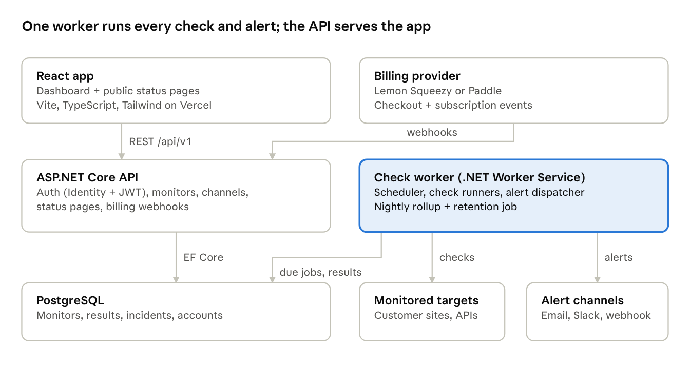
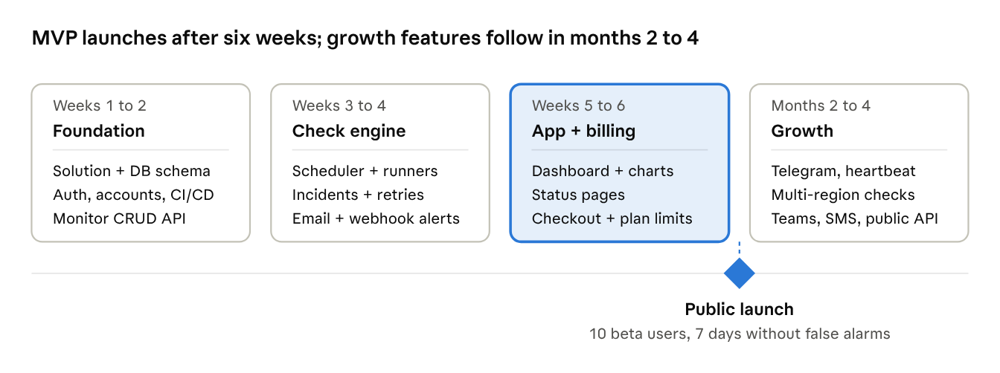

# PingWatch — Uptime Monitor: Product & Technical Documentation

Nov 25, 2026 · @Maalitha

## 1. Overview

PingWatch checks websites, APIs and servers every 1–5 minutes, alerts the owner within 2 minutes of an outage, and publishes a public status page. It is a solo-built micro-SaaS earning monthly USD subscriptions. "PingWatch" is a working name.

**Problem.** Small businesses, freelancers and agencies find out their site is down from customers. Enterprise tools (Datadog, Pingdom) are overkill and priced for teams.

**Target users**

- Freelancers and agencies maintaining client websites
- Indie SaaS founders and small dev teams
- Small businesses with a website or online store

**Goals**

- MVP live and taking payments within 6 weeks
- Detect downtime and alert within 2 minutes on paid plans
- Run on one VPS at under $30/month until 100 paying customers

**Non-goals (v1)**

- APM, log management or server metrics (CPU, RAM)
- Synthetic browser journeys (multi-step login flows)
- On-call scheduling and rotations

## 2. Features

The MVP ships HTTP, keyword, TCP port and SSL checks with email and webhook alerts; everything else waits for paying users to ask.

| Feature                   | Description                                                                           | Phase   |
| ------------------------- | ------------------------------------------------------------------------------------- | ------- |
| HTTP(S) monitor           | GET/HEAD/POST a URL; up when status matches expected (default 200–399) within timeout | MVP     |
| Keyword monitor           | Up when the response body contains (or does not contain) a given string               | MVP     |
| TCP port monitor          | Up when a TCP connection to host:port opens (DB, SMTP, game servers)                  | MVP     |
| SSL expiry check          | Daily certificate check; warn 30, 14, 7 and 1 days before expiry                      | MVP     |
| Response time history     | Per-check latency stored; 24h / 7d / 30d charts                                       | MVP     |
| Uptime % reports          | Uptime for 24h, 7d, 30d, 90d per monitor                                              | MVP     |
| Email alerts              | Down and recovered emails                                                             | MVP     |
| Webhook alerts            | JSON POST to any URL; Slack, Discord, Teams via incoming webhooks                     | MVP     |
| Public status page        | Hosted page per account with selected monitors and incident history                   | MVP     |
| Telegram alerts           | Bot messages to a chat                                                                | Phase 2 |
| Domain expiry check       | WHOIS/RDAP lookup; warn before renewal date                                           | Phase 2 |
| Heartbeat (cron) monitor  | Down when a job stops calling its unique ping URL in time                             | Phase 2 |
| Multi-region checks       | Confirm failures from 2+ locations before alerting                                    | Phase 2 |
| Maintenance windows       | Pause alerts during scheduled work                                                    | Phase 2 |
| Custom status page domain | status.client.com via CNAME                                                           | Phase 2 |
| Team members              | Invite users to an account with roles                                                 | Phase 3 |
| SMS / WhatsApp alerts     | Paid add-on, per-message credits                                                      | Phase 3 |
| Public API                | Manage monitors programmatically with API keys                                        | Phase 3 |

## 3. Plans & pricing

A free tier drives sign-ups; revenue comes from two paid tiers at $9 and $29 per month. Prices are a starting proposal to validate against competitors before launch.

| Plan    | Price (USD/month) | Monitors | Min. interval | Data retention | Status pages      | Alert channels                   |
| ------- | ----------------- | -------- | ------------- | -------------- | ----------------- | -------------------------------- |
| Free    | 0                 | 5        | 5 min         | 7 days         | 1                 | Email                            |
| Starter | 9                 | 25       | 1 min         | 90 days        | 3                 | Email, webhook, Slack/Discord    |
| Pro     | 29                | 100      | 30 sec        | 1 year         | 10, custom domain | All, incl. Telegram; SMS credits |

- Yearly billing at 2 months free (Starter $90/yr, Pro $290/yr).
- Billing through a merchant of record (Lemon Squeezy or Paddle), since Stripe does not onboard Sri Lankan businesses directly. Confirm current availability before integrating.
- Plan limits enforced server-side on monitor create/update and on the scheduler.
- Downgrade: monitors over the new limit are paused, never deleted.

**Break-even.** One VPS at about $20–30/month is covered by 3–4 Starter customers.

## 4. Architecture

Two .NET processes share one PostgreSQL database: the API serves the React app, and a separate worker runs all checks and alerts, so a slow target never slows the dashboard.



The worker and API deploy independently; the worker can scale to several instances because job pickup uses row locks.

| Layer                   | Choice                                                                                | Why                                               |
| ----------------------- | ------------------------------------------------------------------------------------- | ------------------------------------------------- |
| Backend API             | ASP.NET Core 9 Web API, Clean Architecture (Domain, Application, Infrastructure, Api) | Your main stack; fast and typed                   |
| Check worker            | .NET Worker Service (`BackgroundService`) + `System.Threading.Channels`               | No extra broker needed for v1                     |
| ORM                     | EF Core 9 (Npgsql)                                                                    | Migrations, global tenant filters                 |
| Database                | PostgreSQL 16                                                                         | Free, partitioning for check results              |
| Cache / locks (Phase 2) | Redis                                                                                 | Status-page cache, multi-region job queue         |
| Frontend                | React + Vite + TypeScript + Tailwind + shadcn/ui                                      | Your main stack                                   |
| Auth                    | ASP.NET Core Identity + JWT                                                           | Built in                                          |
| Email                   | Resend, Postmark or Amazon SES                                                        | Reliable delivery, free tiers                     |
| Billing                 | Lemon Squeezy or Paddle                                                               | Merchant of record handles global tax             |
| Reverse proxy           | Caddy                                                                                 | Automatic HTTPS, incl. custom status-page domains |
| Hosting                 | Docker Compose on one VPS                                                             | Cheapest start                                    |

## 5. Data model

Eleven tables; `check_results` is the only high-volume table and is partitioned by month and rolled up daily.

| Table                | Key columns                                                                                                                                                                                                                                          | Notes                                                  |
| -------------------- | ---------------------------------------------------------------------------------------------------------------------------------------------------------------------------------------------------------------------------------------------------- | ------------------------------------------------------ |
| accounts             | id, name, plan, billing_customer_id, subscription_status, created_at                                                                                                                                                                                 | One per customer; plan drives limits                   |
| users                | id, account_id, email, password_hash, email_verified, role, created_at                                                                                                                                                                               | ASP.NET Core Identity tables                           |
| monitors             | id, account_id, name, type (http, keyword, tcp, ssl, heartbeat), url, host, port, method, expected_status, keyword, keyword_mode, timeout_ms, interval_sec, status (up, down, paused, pending), last_checked_at, next_check_at, consecutive_failures | `next_check_at` indexed; scheduler reads it            |
| check_results        | id, monitor_id, checked_at, is_up, status_code, response_ms, error, region                                                                                                                                                                           | Partitioned by month; raw rows kept per plan retention |
| daily_stats          | monitor_id, date, checks, failures, uptime_pct, avg_ms, p95_ms                                                                                                                                                                                       | Nightly rollup; powers reports and long-range charts   |
| incidents            | id, monitor_id, started_at, resolved_at, cause, duration_sec                                                                                                                                                                                         | One open incident per monitor at most                  |
| alert_channels       | id, account_id, type (email, webhook, slack, discord, telegram, sms), config_json, is_verified                                                                                                                                                       | Secrets in config_json encrypted at rest               |
| monitor_channels     | monitor_id, channel_id                                                                                                                                                                                                                               | Many-to-many: which channels each monitor alerts       |
| status_pages         | id, account_id, slug, title, custom_domain, logo_url, is_public                                                                                                                                                                                      | Public URL /s/{slug}                                   |
| status_page_monitors | status_page_id, monitor_id, display_name, sort_order                                                                                                                                                                                                 |                                                        |
| alert_log            | id, incident_id, channel_id, type (down, up, ssl_warning), sent_at, success, error                                                                                                                                                                   | Audit and retry tracking                               |

**Database.** PostgreSQL is recommended for cheap hosting and native partitioning; SQL Server works if you prefer it, with the same schema via EF Core migrations.

## 6. Check engine

A background worker runs every due check, confirms failures twice before declaring an outage, and opens or closes incidents.

**Scheduling**

1. Every 5 seconds the scheduler selects monitors where `next_check_at <= now` and status is not paused, using `FOR UPDATE SKIP LOCKED` so several workers never take the same row.
2. It sets `next_check_at = now + interval_sec` immediately, then pushes the job onto an in-process `Channel<T>` queue.
3. A pool of concurrent consumers (start at 100, tune by load) executes checks with `HttpClient` from `IHttpClientFactory`.
4. Each result is written to `check_results` and the monitor's state is updated.

**Check rules**

| Type      | Up when                                                                 | Default timeout |
| --------- | ----------------------------------------------------------------------- | --------------- |
| HTTP      | Status code in expected range; redirects followed (max 5)               | 10 s            |
| Keyword   | HTTP rule passes and body contains / lacks keyword (first 1 MB read)    | 10 s            |
| TCP       | Socket connects to host:port                                            | 5 s             |
| SSL       | Certificate valid, hostname matches, more than threshold days to expiry | 10 s            |
| Heartbeat | Ping URL hit within interval + grace period                             | n/a             |

**Failure confirmation**

- First failure: monitor stays up, retry immediately after 20 seconds.
- Second consecutive failure: monitor goes down, incident opens, alerts fire.
- Phase 2: confirm from a second region before going down, to remove false alarms from local network blips.

**Incident lifecycle**

| From         | Event              | To           | Action                                               |
| ------------ | ------------------ | ------------ | ---------------------------------------------------- |
| pending      | first check passes | up           | none                                                 |
| up           | 1 failure          | up (suspect) | quick retry                                          |
| up (suspect) | retry fails        | down         | open incident, send down alert                       |
| up (suspect) | retry passes       | up           | none                                                 |
| down         | check passes       | up           | close incident, record duration, send recovery alert |
| any          | user pauses        | paused       | stop scheduling, no alerts                           |

**Rollup.** A nightly job aggregates yesterday's rows into `daily_stats` and drops raw partitions past the plan's retention.

## 7. Alerting

Alerts go out through a queued dispatcher with retries, one down and one recovery alert per incident plus at most hourly reminders, so users are never spammed.

| Channel                 | How it's sent                                           | Setup                                          | Phase   |
| ----------------------- | ------------------------------------------------------- | ---------------------------------------------- | ------- |
| Email                   | Transactional provider (Resend, Postmark or Amazon SES) | Verified address                               | MVP     |
| Webhook                 | POST JSON payload, 10 s timeout                         | URL, optional secret for HMAC signature header | MVP     |
| Slack / Discord / Teams | Their incoming-webhook URL with a formatted message     | Paste webhook URL                              | MVP     |
| Telegram                | Bot API sendMessage                                     | Start bot, link chat via code                  | Phase 2 |
| SMS / WhatsApp          | Gateway (e.g. Twilio, Notify.lk) billed as credits      | Verified number                                | Phase 3 |

**Rules**

- Down alert when an incident opens; recovery alert with outage duration when it closes.
- Reminder every 60 minutes while still down (user can switch off).
- SSL warnings at 30, 14, 7 and 1 days; each sent once.
- Failed sends retried 3 times with backoff (30 s, 2 min, 10 min), logged in `alert_log`.
- Channel test button sends a sample alert before saving.

**Webhook payload**

```json
{
  "event": "monitor.down",
  "monitor": {
    "id": "mon_123",
    "name": "Client site",
    "url": "https://example.com"
  },
  "incident": {
    "id": "inc_456",
    "startedAt": "2026-11-25T08:15:00Z",
    "cause": "HTTP 503"
  },
  "sentAt": "2026-11-25T08:15:42Z"
}
```

## 8. API

The React app talks to a versioned REST API at `/api/v1`, authenticated with JWT access tokens (15 min) and HTTP-only refresh cookies; public status pages and heartbeat pings need no auth.

| Method                    | Endpoint                                     | Purpose                                                                        |
| ------------------------- | -------------------------------------------- | ------------------------------------------------------------------------------ |
| POST                      | /auth/register                               | Create account + owner user, send verification email                           |
| POST                      | /auth/login                                  | Issue access token + refresh cookie                                            |
| POST                      | /auth/refresh                                | Rotate tokens                                                                  |
| POST                      | /auth/logout                                 | Revoke the current session and clear the refresh cookie                        |
| POST                      | /auth/forgot-password, /auth/reset-password  | Password reset flow                                                            |
| GET                       | /monitors                                    | List monitors with current status and 24h uptime                               |
| POST                      | /monitors                                    | Create monitor (plan limits checked)                                           |
| GET                       | /monitors/{id}                               | Monitor detail                                                                 |
| PUT                       | /monitors/{id}                               | Update monitor                                                                 |
| DELETE                    | /monitors/{id}                               | Delete monitor and its history                                                 |
| POST                      | /monitors/{id}/pause, /monitors/{id}/resume  | Pause or resume checks                                                         |
| GET                       | /monitors/{id}/results?from=&to=             | Raw check results (paged)                                                      |
| GET                       | /monitors/{id}/stats?range=24h\|7d\|30d\|90d | Uptime % and response-time series                                              |
| GET                       | /incidents?monitorId=&status=                | Incident list                                                                  |
| GET / POST / PUT / DELETE | /channels, /channels/{id}                    | Manage alert channels                                                          |
| POST                      | /channels/{id}/test                          | Send a test alert                                                              |
| GET / POST / PUT / DELETE | /status-pages, /status-pages/{id}            | Manage status pages                                                            |
| GET                       | /account, /account/usage                     | Plan, limits, usage                                                            |
| POST                      | /billing/checkout                            | Create checkout session at billing provider                                    |
| POST                      | /billing/webhook                             | Provider events: subscription created, updated, cancelled (signature verified) |
| GET                       | /public/status/{slug}                        | Public status page data (no auth, cached 30 s)                                 |
| GET / POST                | /hb/{token}                                  | Heartbeat ping (no auth)                                                       |

Errors return RFC 7807 problem details. OpenAPI spec generated with Swashbuckle or the built-in .NET OpenAPI support.

## 9. Frontend

One React + Vite + TypeScript + Tailwind app serves the marketing site, the dashboard and public status pages; the dashboard refreshes status every 30 seconds.

| Page               | Route                                     | Contents                                                                                    |
| ------------------ | ----------------------------------------- | ------------------------------------------------------------------------------------------- |
| Landing            | /                                         | Value proposition, pricing table, sign-up CTA                                               |
| Sign up / Log in   | /signup, /login                           | Email + password, verification, forgot password                                             |
| Dashboard          | /app                                      | All monitors: status dot, name, uptime 24h, last response time, sparkline; filter by status |
| Monitor detail     | /app/monitors/:id                         | Status, uptime 24h/7d/30d/90d, response-time chart, incident list, recent checks            |
| New / edit monitor | /app/monitors/new, /app/monitors/:id/edit | Type picker, URL/host, interval, timeout, expected status, keyword, alert channels          |
| Incidents          | /app/incidents                            | Open and past incidents with duration and cause                                             |
| Alert channels     | /app/channels                             | Add, verify, test, delete channels                                                          |
| Status pages       | /app/status-pages                         | Create page, pick monitors, slug, logo, custom domain                                       |
| Billing            | /app/billing                              | Current plan, usage vs limits, upgrade, invoices link                                       |
| Settings           | /app/settings                             | Profile, password, timezone, delete account                                                 |
| Public status page | /s/:slug                                  | Overall status banner, per-monitor 90-day uptime bars, recent incidents                     |

**Key flows**

1. **Onboarding:** sign up, verify email, "add your first monitor" wizard with URL only, then email alert set by default. Target: first monitor live in under 60 seconds.
2. **Outage:** alert email links straight to monitor detail showing the error and status code.
3. **Upgrade:** hitting a plan limit shows an inline upgrade prompt that opens checkout.

**Libraries:** TanStack Query (data fetching and polling), React Router, Recharts (charts), React Hook Form + Zod (forms), shadcn/ui (components).

## 10. Security, reliability and non-functional requirements

The biggest risks are the checker being abused to hit internal networks (SSRF) and false alarms; both are handled in v1.

**Security**

- **SSRF protection:** resolve each target's DNS before every check and block private, loopback, link-local and metadata ranges (10.0.0.0/8, 172.16.0.0/12, 192.168.0.0/16, 127.0.0.0/8, 169.254.0.0/16, ::1, fc00::/7). Re-check after redirects.
- **Abuse limits:** plan-based monitor caps, minimum intervals, and a per-target-host rate cap so the service can't be used to flood a site.
- **Auth:** ASP.NET Core Identity, bcrypt/PBKDF2 hashes, email verification, rate-limited login (5 attempts/min per IP).
- **Secrets:** webhook URLs and tokens encrypted with ASP.NET Core Data Protection; app secrets in environment variables, never in git.
- **Tenancy:** every query filtered by `account_id` (EF Core global query filter).
- **Billing webhooks:** signature verified; idempotent by event id.
- HTTPS everywhere, HSTS, CORS locked to the app domain, security headers.

**Non-functional targets**

| Requirement                | Target                                 |
| -------------------------- | -------------------------------------- |
| Alert latency (paid)       | Under 2 min from outage start          |
| Scheduler drift            | Under 10 s from `next_check_at`        |
| Check capacity, single VPS | about 1,000 checks/min                 |
| Dashboard API p95          | Under 300 ms                           |
| Platform uptime            | 99.9%                                  |
| Status page load           | Under 1 s, cached                      |
| Backups                    | Daily DB dump, 14 days kept off-server |

**Privacy.** Store only account email and monitor config; publish a privacy policy and terms before charging.

## 11. Deployment & operations

Everything runs as Docker containers on one VPS behind Caddy, deployed by GitHub Actions; estimated running cost is $15–30 per month.

**Hosting**

| Component                                   | Where                                  | Est. cost (USD/month) |
| ------------------------------------------- | -------------------------------------- | --------------------- |
| VPS, 4 vCPU / 8 GB (API, worker, DB, Redis) | Hetzner or DigitalOcean                | 10–25                 |
| Frontend (static build)                     | Vercel or Cloudflare Pages             | 0                     |
| Transactional email                         | Resend / Postmark free tier, then paid | 0–15                  |
| Off-site backups                            | Backblaze B2 or Cloudflare R2          | 1                     |
| Domain                                      | Registrar of choice                    | about 1               |
| Phase 2 probe nodes (2 extra regions)       | Small VPS each                         | 5–10                  |

**CI/CD**

1. Push to `main` runs build + unit tests + integration tests (Testcontainers for PostgreSQL).
2. Docker images built and pushed to GitHub Container Registry.
3. Deploy job SSHs to the VPS and runs `docker compose pull && docker compose up -d`; EF Core migrations run at API startup behind a flag.

**Monitoring the monitor**

- Structured logs with Serilog to a file sink, plus Seq (self-hosted) or Grafana Loki.
- Health endpoints `/health/live` and `/health/ready` on API and worker.
- An external free monitor (a second provider) watches PingWatch itself and its public status page.
- Worker heartbeat: if the scheduler hasn't run a cycle for 60 s, it alerts the founder.

**Scaling path**

- Up to about 1,000 checks/min: single VPS.
- Beyond: move the DB to a managed instance, run 2+ worker containers (`SKIP LOCKED` already prevents duplicates), add regional probe nodes that pull jobs from Redis and post results back.

## 12. Roadmap & milestones

The MVP is six weeks of part-time work; public launch waits until 10 beta users have run it for 7 days without a false alarm.



Phase 2 and 3 features are ordered by what paying users request most, not fixed in advance.

**Launch checklist**

- [ ] Privacy policy, terms and refund policy published
- [ ] Landing page with pricing and a live demo status page
- [ ] Billing tested end to end in sandbox, then live
- [ ] External monitor watching PingWatch itself
- [ ] Launch posts: MJ Dev Tips (Facebook, LinkedIn), Product Hunt, Indie Hackers, r/SideProject
- [ ] Offer free Starter for 3 months to the first 20 agency users in exchange for feedback
